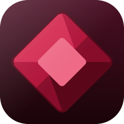
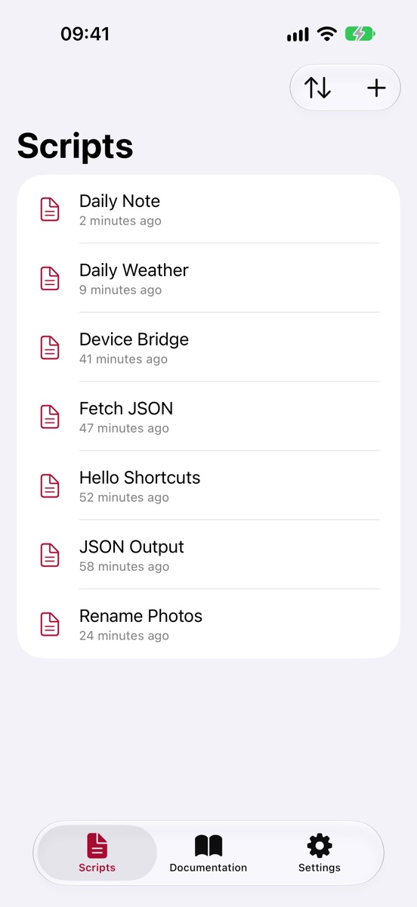
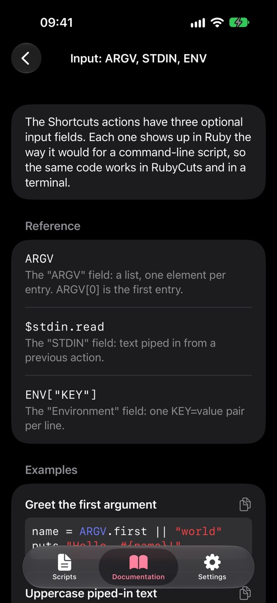
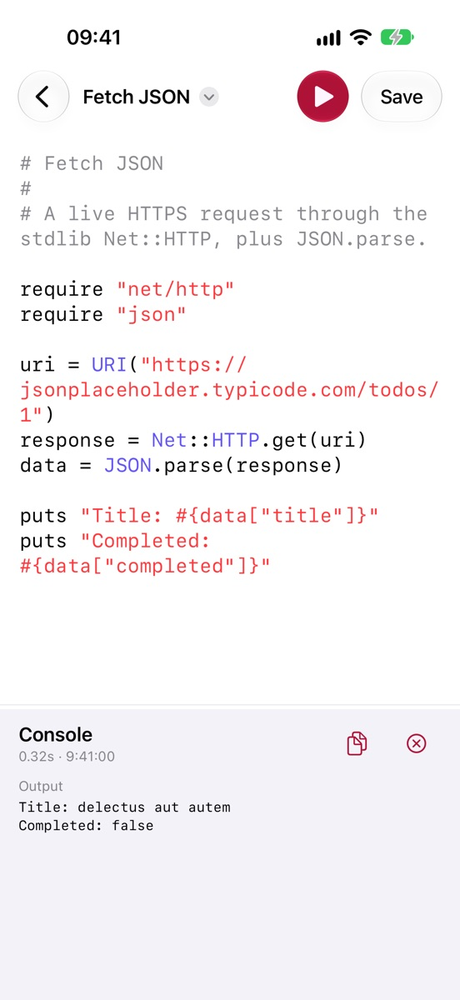
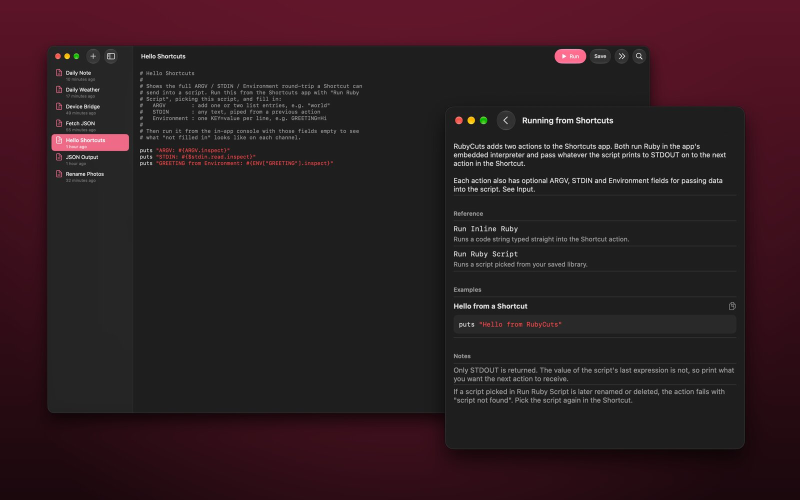

  

<h1 align="center">RubyCuts</h1>

Write real Ruby, run it from Shortcuts. On iPhone, iPad and Mac.

  <a href="https://apps.apple.com/app/id6829294399">
    <picture>
      <source srcset="docs/images/app-store-badge-white.svg" media="(prefers-color-scheme: dark)">
      
    </picture>
  </a>

  
  
  

  

RubyCuts is an open-source, universal Apple app (iOS, iPadOS, macOS) that lets you write, manage, and run Ruby code natively from Apple Shortcuts. More on the [website](https://janstol.github.io/RubyCuts/).

It's inspired by [Rubyist](https://rubyist.app), but aims to be actively maintained and to embed the full CRuby (MRI) environment instead of the limited `mruby` VM, giving you real standard library access (`csv`, `json`, `net/http`, ...) and the ability to pull in pure Ruby gems at runtime.

## Features

- **Real Ruby.** CRuby 3.4.9 (MRI) embedded in the app, with its standard library: `json`, `csv`, `yaml`, `net/http` over HTTPS, `openssl` and more.
- **Shortcuts actions.** "Run Inline Ruby" and "Run Ruby Script" take `ARGV` (a list), `STDIN` and `ENV` from the Shortcut and return `STDOUT` to the next action. A script that raises or writes to `STDERR` fails the Shortcut with Ruby's error message.
- **Script editor.** Syntax highlighting, a console with output, errors, backtrace and timing, a Stop button for runaway scripts, plus search, sort, rename and sample scripts to start from.
- **iCloud Drive sync.** Scripts live in a "RubyCuts" folder in iCloud Drive, so they sync between your devices and you can edit them in any editor. Without iCloud they're kept on the device.
- **Gems.** Search and install pure-Ruby gems from rubygems.org, dependencies included, and `require` them right away. `sqlite3` comes bundled. Gems with C extensions can't be installed (Apple doesn't allow loading downloaded native code).
- **Widgets.** Put a script on your Home Screen or Mac desktop: the "Ruby Script" widget runs it on the system's refresh schedule and draws what it builds with `WidgetUI` (text, SF Symbols, stacks, colors), in small, medium and large sizes. Tapping the widget opens the script.
- **Native bridge.** `Device::Clipboard` and `Device::Notification` let scripts read and write the clipboard and post notifications.
- **iPhone, iPad and Mac.** One universal app, with a menu bar, keyboard shortcuts and a Settings window on the Mac, and a built-in reference for the Ruby-to-Shortcuts contract.

## Requirements

iOS 26+ / iPadOS 26+, or macOS 26+.

## Development

See [`docs/development.md`](docs/development.md) for building CRuby, the Xcode project, running tests, signing and the mise tasks.

## License

[MIT](LICENSE)
